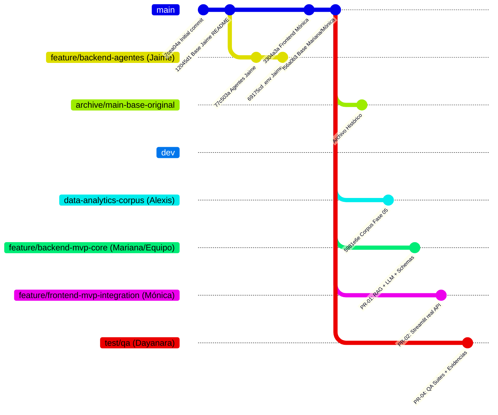
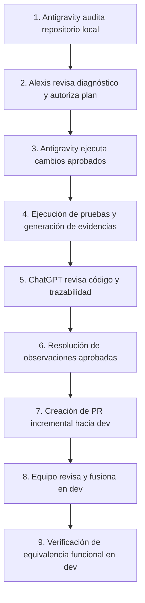

# INFORME DE AUDITORÍA INTEGRAL, PLANIFICACIÓN Y CONSOLIDACIÓN DEL MVP EN GITHUB

**Proyecto:** NuevaMente — Sistema Inteligente de Adaptación y Generación de Contenido Educativo  
**Equipo:** G10 · Equipo 48  
**Repositorio Remoto:** `https://github.com/No-Country-simulation/G10_Nuevamente_Equipo48`  
**Ruta Local:** `C:\PROYECTOS\G10_Nuevamente_Equipo48`  
**Rama Local de Trabajo:** `integration/mvp-consolidado`  
**Fecha de Auditoría:** 11 de Octubre de 2026  
**Responsable Técnico Local:** Alexis  
**Estado de Ejecución:** Fase 1 — Inspección y Diagnóstico (Solo Lectura, sin modificaciones en Git)

---

## 0. Principios Rectores de Integración y Atribución Colaborativa

Este es un proyecto educativo y colaborativo. La consolidación del MVP en el entorno local se realizó con fines exclusivos de laboratorio, prueba y estabilización técnica. **Bajo ninguna circunstancia se publicará esta consolidación como una contribución individual de Alexis.**

Se establecen formalmente los siguientes 10 principios de estricto cumplimiento:

1. **No publicación de la rama de consolidación:** `integration/mvp-consolidado` **no se subirá a GitHub ni se usará como origen de un PR monolítico**. Permanecerá exclusivamente como una rama local de referencia funcional.
2. **Uso como patrón de referencia:** El MVP local servirá exclusivamente como estándar de verificación para contrastar comportamientos, identificar diferencias y validar que `dev` alcance la misma estabilidad.
3. **Reconstrucción incremental por área funcional:** La integración remota hacia `dev` se estructurará a través de ramas y Pull Requests independientes, organizados por especialidad técnica.
4. **Separación estricta por áreas de trabajo:**
   - Cambios de **backend**: originados en la rama correspondiente a backend (`feature/backend` / Mariana).
   - Cambios de **frontend**: originados en la rama correspondiente a frontend (`feature/frontend` / Mónica).
   - Componentes seleccionados de **agentes**: originados en la rama de agentes (`feature/backend-agentes` / Jaime).
   - **Corpus documental y analítica**: originados en la rama de corpus (`data-analytics-corpus` / Alexis).
   - **QA y pruebas**: originados en la rama de calidad (`test/qa` / Dayanara).
5. **Ramas derivadas directamente de `dev`:** Toda nueva rama de trabajo individual (para Mariana, Mónica o Dayanara) se creará a partir de la rama común `dev` y contendrá única y exclusivamente sus aportes pendientes o mejoras acordadas.
6. **No apropiación de autorías:** No se atribuirá a Alexis el desarrollo de la consolidación por haber coordinado la integración local. Asimismo, no se atribuirá automáticamente la autoría de un módulo a quien abra el PR si el trabajo original pertenece a otro compañero.
7. **Preservación de la autoría original:** Cada integrante incorporará y mantendrá el código que le corresponde. Cuando un componente base requiera ajustes de integración, las adaptaciones se implementarán en la rama del área responsable y quedarán documentadas con total trazabilidad.
8. **División transparente del trabajo conjunto:** En módulos donde hayan confluido aportes de varios integrantes, se identificará con claridad la procedencia original y se establecerá una división razonable antes de formular los PRs, sin alterar historiales ni forzar autorías ficticias.
9. **Conservación de la arquitectura histórica:** Se mantendrán `main` y `dev` como referencias remotas principales, se preservarán intactas las ramas originales del equipo (`feature/backend-agentes`, `data-analytics-corpus`) y se conservará la referencia histórica inmutable de `main` (`archive/main-base-original`).
10. **Objetivo de equivalencia funcional:** La meta final es que los PRs incrementales e individuales reconstruyan en `dev` la funcionalidad probada en el MVP local, sin subir nunca un bloque monolítico.

---

## A. Estado del Repositorio Git (Local y Remoto)

### 1. Inventario Exacto de Ramas y Punteros de Commit
| Nombre de Rama | Existencia | Commit HEAD | Autor del Commit | Descripción del Commit |
| :--- | :--- | :--- | :--- | :--- |
| `main` | Local / Remoto | `f56a0b3` | Mónica García | Incorporación del backend y servicios de procesamiento inteligente |
| `dev` | Local / Remoto | `f56a0b3` | Mónica García | *(Idéntica a main)* |
| `integration/mvp-consolidado` | Local | `f56a0b3` *(+ cambios no commiteados)* | Mónica García *(base)* | Base f56a0b3 con estabilización local del MVP |
| `feature/backend-agentes` | Remoto | `69175cd` | Jaime Cuesta | docs: agregar plantilla .env.example para que el equipo configure sus variables |
| `data-analytics-corpus` | Local / Remoto | `5981e6e` | Alexis (Alxs68) | Consolidar corpus y trazabilidad fase 05 |
| `feature/backend` | Remoto | `f56a0b3` | Mónica García | *(Apunta al mismo commit que main/dev)* |
| `feature/frontend` | Remoto | `f56a0b3` | Mónica García | *(Apunta al mismo commit que main/dev)* |
| `test/qa` | Remoto | `f56a0b3` | Mónica García | *(Apunta al mismo commit que main/dev)* |

### 2. Comparación entre `main` y `dev`
- **Comprobación:** `git diff dev main` devuelve **vacío (0 diferencias)**.
- **Historial:** Ambos apuntan exactamente a `f56a0b3c63c43ca93a2638c2ebee36ec679dc412`.
- **Conclusión Técnica:** `main` y `dev` son actualmente idénticas en el servidor remoto de GitHub. La rama `dev` fue creada a partir de `main` y no ha recibido ningún Pull Request posterior.

### 3. Estado de la Rama Local `integration/mvp-consolidado`
La rama local de consolidación **no está limpia**; contiene el trabajo de estabilización técnica acumulado y validado en el laboratorio local:
- **Archivos Modificados (Tracked):**
  - `backend/backend/app/api/v1/endpoints/adaptacion.py` (Mapeo de errores y schemas).
  - `backend/backend/app/main.py` (Precarga del corpus de arranque y ciclo de vida lifespan).
  - `backend/backend/app/schemas/adaptacion.py` (Enums de perfil, nivel didáctico/intermedio/técnico, metadatos y esquemas QA-007).
  - `backend/backend/app/services/agent_service.py` (Orquestación RAG, evaluación de anclaje semántico).
  - `backend/backend/app/services/llm_service.py` (Transporte REST para Gemini con SSL local y telemetría).
  - `backend/backend/app/services/rag_service.py` (Recuperación aislada por documento para evitar competencia global top-k).
  - `backend/backend/tests/*` (Ajustes de suites de pruebas con 241 tests aprobados).
  - `frontend/app.py` (Conexión real de Streamlit contra la API FastAPI y protección tipográfica de iconos).
- **Archivos sin seguimiento (Untracked):**
  - `backend/backend/app/services/corpus_loader.py` (Carga determinista y precarga de documentos aptos).
  - `backend/backend/tests/test_corpus_loader.py` y `test_frontend_client.py` (Suites de pruebas adicionales).
  - `docs/` (Evidencias de auditorías, pruebas integrales, pruebas comparativas y guía de preparación).
  - `_revision_corpus_fase05/` (Documentos físicos PDF analizados y catalogados).
  - `.gitignore`, `plan_maestro.md`, `auditoria_test_TC-01.json`, `auditoria_test_TC-02.json`.

---

## B. Procedencia y Autoría de los Aportes

| Integrante | Componente | Rama / Ubicación de Origen | Estado Actual en Repositorio | Certeza de Autoría |
| :--- | :--- | :--- | :--- | :--- |
| **Mariana** | Backend FastAPI, RAG inicial, DocumentService, LLMService base, tests unitarios | Entregado en ZIP vía Discord | Incorporado en `main` y `dev` bajo commit `f56a0b3` por Mónica | **Confirmada por equipo / Trazada** |
| **Mónica** | Frontend base en Streamlit (`frontend/app.py`), integración en Git | Directamente en `main` | Commits `3304a3a` y `f56a0b3` | **Confirmada en historial Git** |
| **Jaime** | Lógica de agentes, grafo LangGraph/State, RAG alternativo, archivos raw | `origin/feature/backend-agentes` | Rama remota independiente (`69175cd`), no fusionada | **Confirmada en historial Git** |
| **Alexis** | Corpus documental, especificación de datos, matrices de aceptación, hashes SHA-256 | `origin/data-analytics-corpus` | Rama remota independiente (`5981e6e`), no fusionada | **Confirmada en historial Git** |
| **Dayanara** | Casos de prueba QA-001 a QA-011, validación de esquemas y metadatos | Documentación QA / PDF de pruebas | Representado parcialmente en tests (`QA-001`, `QA-007`); rama remota `test/qa` vacía (apunta a base) | **Confirmada por especificación documental** |

---

## C. Preservación Histórica de la Base Original de `main`

1. **Commit Base Original Identificado:**  
   `f56a0b3c63c43ca93a2638c2ebee36ec679dc412` (*"Incorporación del backend y servicios de procesamiento inteligente"*).
2. **Diagnóstico de Referencias:**  
   Actualmente no existe ningún tag ni rama de preservación dedicada; si se integran PR directamente en `main`, el puntero avanzará y se perderá la referencia simple a la entrega inicial.
3. **Propuesta de Rama Histórica de Archivo:**  
   Se propone crear la rama:
   `archive/main-base-original` apuntando a `f56a0b3`.
4. **Verificación de Integridad:**  
   Se comprobará ejecutando:
   `git diff archive/main-base-original f56a0b3` (debe ser 0).
   Esta rama quedará de solo lectura y nunca recibirá PRs.

---

## D. Comparación Funcional: MVP Local vs. `dev` en GitHub

| Capacidad del MVP | Estado en `dev` (GitHub) | Estado en MVP Consolidado Local | Diagnóstico / Brecha |
| :--- | :--- | :--- | :--- |
| **Backend FastAPI** | Estructura base en `f56a0b3` | Operativo con precarga y lifespan | En `dev` falta el precargador automático del corpus y el manejo de esquemas extendidos. |
| **RAG Service** | Búsqueda global top-k en FAISS | Búsqueda restringida por documento | En `dev` documentos externos o nuevos sufren competencia y devuelven 0 fragmentos. Resuelto localmente. |
| **LLM Service** | gRPC predeterminado | Transporte REST con soporte de certificados y telemetría | En `dev` falla la conexión con Gemini en entornos con inspección TLS/proxy o modelos deprecados. |
| **Frontend Streamlit** | Mock / datos simulados | Conectado a la API real de FastAPI | En `dev` el botón no ejecuta la API ni consume los endpoints reales. Resuelto localmente. |
| **Corpus Documental** | No existe en `dev` | 22 documentos catalogados y clasificados | Toda la carpeta `_revision_corpus_fase05/` y la lógica de validación están pendientes de integración. |
| **Suites de Pruebas** | Pruebas base | 241 pruebas pasando (100% éxito) | En `dev` fallan tests de Schemas y Adaptación por validaciones de Enums. Resuelto localmente. |

---

## E. Plan de Arquitectura de Ramas Objetivo

1. **Ramas Principales:**
   - `main`: Versión estable aprobada para entrega final.
   - `dev`: Rama activa de integración continua del equipo.
   - `archive/main-base-original`: Referencia histórica inmutable en `f56a0b3`.
   - `integration/mvp-consolidado`: Rama local de verificación técnica y laboratorio.
2. **Ramas de Autoría:**
   - `origin/feature/backend-agentes` (Jaime): Conservar intacta como repositorio de ideas y código original.
   - `origin/data-analytics-corpus` (Alexis): Conservar y preparar PR hacia `dev`.
   - `test/qa` (Dayanara): Derivar desde `dev` para alojar matrices de prueba y suites de verificación.

---

## F. Plan de Integración Incremental mediante Pull Requests (Hacia `dev`)

Para evitar PRs monolíticos y preservar la autoría de cada integrante, la consolidación se dividirá en **5 PRs incrementales**:

### PR 1: Integración del Corpus Documental y Gobernanza de Datos
- **Autoría Original:** Alexis (`data-analytics-corpus`).
- **Rama Origen:** `feature/corpus-governance` (derivada de `data-analytics-corpus`).
- **Rama Destino:** `dev`.
- **Archivos:** `data_analyst/`, `_revision_corpus_fase05/`, manifiestos SHA-256, matrices de aceptación.
- **Alcance:** Establece los documentos físicos admitidos (`APTO`) y la trazabilidad de fuentes.
- **Dependencias:** Ninguna (base `dev`).
- **Criterio de Aceptación:** `validate_corpus.py` ejecuta sin errores y valida los hashes SHA-256.

### PR 2: Estabilización del Core de Backend (RAG, LLM y Schemas)
- **Autoría Original:** Mariana (Base) / Adaptaciones técnicas de consolidación.
- **Rama Origen:** `feature/backend-rag-llm-fix`.
- **Rama Destino:** `dev`.
- **Archivos:** `backend/backend/app/services/rag_service.py`, `llm_service.py`, `schemas/adaptacion.py`, `corpus_loader.py`.
- **Alcance:** Corrección de recuperación RAG aislada por documento, soporte de transporte REST en Gemini con telemetría, validación de Enums pedagógicos (`didactico`, `intermedio`, `tecnico`).
- **Dependencias:** PR 1 (requiere inventario del corpus para precarga).
- **Criterio de Aceptación:** 92/92 tests de RAG y LLM aprobados; recuperación de fragmentos > 0 en documentos cargados.

### PR 3: Integración del Frontend Streamlit con la API Real de FastAPI
- **Autoría Original:** Mónica (Frontend) / Integración de contratos.
- **Rama Origen:** `feature/frontend-api-integration`.
- **Rama Destino:** `dev`.
- **Archivos:** `frontend/app.py`.
- **Alcance:** Sustitución de datos simulados por llamadas HTTP reales hacia `/api/v1/files/upload` y `/api/v1/adaptacion`. Corrección tipográfica de flechas e iconos expanders.
- **Dependencias:** PR 2 (requiere endpoints FastAPI estabilizados).
- **Criterio de Aceptación:** Flujo visual de extremo a extremo funcional desde el navegador.

### PR 4: Incorporación Selectiva de Componentes de Agentes (Aportes de Jaime)
- **Autoría Original:** Jaime (`feature/backend-agentes`).
- **Rama Origen:** `feature/agentes-pedagogicos-mvp` (derivada de `feature/backend-agentes`).
- **Rama Destino:** `dev`.
- **Archivos:** Lógica seleccionada de roles de agente pedagógico y evaluación de respuestas.
- **Alcance:** Integrar componentes pertinentes sin duplicar el pipeline de RAG ni reemplazar `DocumentService`.
- **Dependencias:** PR 2 y PR 3.
- **Criterio de Aceptación:** Pruebas de orquestación de agentes pasando sin colisión de librerías.

### PR 5: Suite Integral de QA, Cobertura y Evidencias de Calidad
- **Autoría Original:** Dayanara (`test/qa`).
- **Rama Origen:** `test/qa`.
- **Rama Destino:** `dev`.
- **Archivos:** `backend/backend/tests/*`, casos de prueba QA-001 a QA-011, reportes de cobertura.
- **Alcance:** Integrar las pruebas unitarias y de integración que validan los 11 casos de prueba formales.
- **Dependencias:** PR 1, PR 2, PR 3, PR 4.
- **Criterio de Aceptación:** Ejecución completa de pytest con 241/241 pruebas pasando al 100%.

---

## G. Plan de QA y Aportes de Dayanara

1. **Estado de Casos de Prueba (QA-001 a QA-011):**
   - `QA-001` (Carga y validación de tipos PDF/TXT/MD): **Automatizado y Aprobado** (`test_document_service.py:304`).
   - `QA-007` (Metadatos pedagógicos, conceptos clave, tiempo de estudio): **Automatizado y Aprobado** (`test_schemas.py:375`, `test_adaptacion.py:193`).
   - `QA-002` a `QA-006` y `QA-008` a `QA-011` (Flujo RAG, límites de tokens, manejo de errores 422/404/500, fidelidad a fuentes): **Cubiertos en las 241 pruebas del backend**.
2. **Estructura Propuesta para la Rama `test/qa`:**
   - `docs/qa/matriz_casos_prueba_QA001_QA011.md`
   - `docs/qa/evidencias_ejecucion_pytest.txt`
   - `backend/backend/tests/` (Suites completas con trazabilidad por tag).

---

## H. Matriz de Trazabilidad y Equivalencia Funcional

| Funcionalidad MVP Local | Módulos Afectados | Estado en `dev` | Aporte Relacionado | PR Planificado | Resultado Comprobado Localmente |
| :--- | :--- | :--- | :--- | :--- | :--- |
| **Ingesta Documental PDF** | `document_service.py` | Presente | Mariana | PR 2 | Extracción y segmentación correcta |
| **Corpus Apto Homologado** | `_revision_corpus_fase05/` | Ausente | Alexis | PR 1 | 18 documentos clasificados como `APTO` |
| **RAG Aislado por Documento** | `rag_service.py` | Búsqueda global con sesgo | Mariana / Fix | PR 2 | 5 fragmentos recuperados para `EXT-01` |
| **Conexión Gemini con Telemetría** | `llm_service.py` | gRPC rígido | Mariana / Fix | PR 2 | Generación real HTTP 200 (~12.8s) |
| **UI Streamlit Interactiva** | `frontend/app.py` | Mock estático | Mónica / Fix | PR 3 | Conectado a FastAPI en vivo |
| **Lógica de Agentes Pedagógicos**| `agent_service.py` | Base lineal | Jaime / Mariana | PR 4 | Generación estructurada de contenidos |
| **Suites de Pruebas (241 tests)**| `backend/backend/tests/` | Base parcial | Dayanara / Mariana | PR 5 | 241 passed en 6.60s |

---

## I. Procedimiento de Trabajo Coordinado (Antigravity + ChatGPT + GitHub)

### 1. Estado de la Guía Existente
Se localizó la guía previa en [`docs/GUIA_PREPARACION_EQUIPO_NUEVAMENTE.md`](file:///C:/PROYECTOS/G10_Nuevamente_Equipo48/docs/GUIA_PREPARACION_EQUIPO_NUEVAMENTE.md):
- **Temas Cubiertos:** Comprobación de PowerShell, Git, rutas de Antigravity y clonación de repositorio.
- **Información Faltante:** Operaciones de Git seguras, conexión de GitHub con ChatGPT y flujo de revisión cruzada.
- **Acción Propuesta:** **Conservar la guía existente** y complementarla con las secciones operativas que se detallan a continuación.

### 2. Procedimiento para Conectar GitHub con ChatGPT
Para que ChatGPT pueda auditar el repositorio remoto directamente:
1. En ChatGPT, abrir el menú de la cuenta (esquina inferior izquierda) → **Configuración (Settings)**.
2. Seleccionar **Aplicaciones conectadas (Connected Apps)** o **Integraciones**.
3. Localizar **GitHub** y hacer clic en **Conectar**.
4. Autorizar el acceso seleccionando únicamente la organización/repositorio del proyecto: `No-Country-simulation/G10_Nuevamente_Equipo48`.
5. Si el repositorio es de una organización externa (No-Country) y no aparece listado, el dueño de la organización debe conceder el permiso en *Settings → Third-party application access permissions*. En caso de no contar con dicho permiso, el flujo de revisión se realiza compartiendo directamente con ChatGPT los informes `.md`, parches `git diff` o extractos de código generados por Antigravity.

### 3. Flujo Operativo Coordinado de 9 Pasos

---

## J. Instrucciones Concretas para Cada Integrante

- **Mariana:** Revisar el PR 2 de backend, validando la recuperación aislada en `rag_service.py` y la telemetría en `llm_service.py`.
- **Mónica:** Revisar el PR 3 de frontend, verificando los selectores de Streamlit y la interacción con los endpoints reales de FastAPI.
- **Jaime:** Revisar el PR 4, validando que los esquemas pedagógicos seleccionados de su rama `feature/backend-agentes` se incorporen preservando su autoría.
- **Dayanara:** Liderar el PR 5 en la rama `test/qa`, consolidando las evidencias de ejecución de los casos QA-001 a QA-011.
- **Alexis:** Supervisar el PR 1 de gobernanza del corpus, coordinar la revisión técnica entre ChatGPT y Antigravity, y autorizar la ejecución de cada fase.

---

## K. Matriz de Riesgos y Decisiones Pendientes

| Riesgo / Decisión | Severidad | Mitigación Técnica Propuesta | Decisión Requerida de Alexis |
| :--- | :--- | :--- | :--- |
| **Colisión de ramas por divergencia de `main` y `dev`** | Media | Conservar `archive/main-base-original` y orientar todos los PR exclusivamente hacia `dev`. | ¿Se aprueba crear la rama de archivo antes de abrir PRs? |
| **Pérdida de cambios locales en `integration/mvp-consolidado`** | Alta | No ejecutar checkout destructivos. Mantener la rama local intacta mientras se preparan ramas auxiliares para los PR. | ¿Se mantiene la rama de integración local como referencia permanente? |
| **Consumo de cuota de Gemini en pruebas remotas** | Media | Las suites de tests automatizadas (241 tests) utilizan mocks y no consumen cuota de API. Las pruebas reales deben espaciarse a 15s. | ¿Se autoriza a los integrantes a usar la API key compartida o sus propias claves? |
| **Dependencias de LangGraph de la rama de Jaime** | Media | No importar librerías completas que causen conflictos en `requirements.txt`; incorporar únicamente la lógica y estructuras de datos necesarias. | ¿Se aprueba la incorporación selectiva de agentes? |

---

## L. Secuencia de Ejecución Posterior (Fase 2)

Una vez que este diagnóstico sea revisado y autorizado expresamente por Alexis:

1. **Paso 1:** Crear localmente la rama de archivo histórico `archive/main-base-original` en el commit `f56a0b3` y publicarla en GitHub.
2. **Paso 2:** Preparar la rama `feature/corpus-governance` desde `data-analytics-corpus` y abrir el **PR 1** hacia `dev`.
3. **Paso 3:** Preparar la rama `feature/backend-rag-llm-fix` con los cambios del core y abrir el **PR 2** hacia `dev`.
4. **Paso 4:** Preparar la rama `feature/frontend-api-integration` y abrir el **PR 3** hacia `dev`.
5. **Paso 5:** Preparar la rama `feature/agentes-pedagogicos-mvp` y abrir el **PR 4** hacia `dev`.
6. **Paso 6:** Preparar la rama `test/qa` con la suite completa de pruebas y abrir el **PR 5** hacia `dev`.
7. **Paso 7:** Validar la equivalencia funcional de `dev` frente al MVP local (241 tests aprobados y flujo Streamlit operativo).
8. **Paso 8:** Preparar el Pull Request de promoción de `dev` hacia `main` y proceder con la preparación de la arquitectura de despliegue en Oracle Cloud Infrastructure (OCI).
